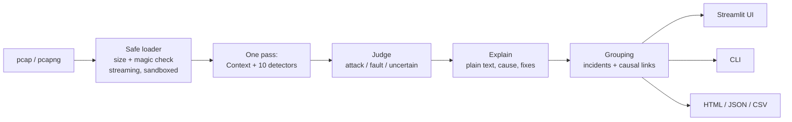

# CaughtIn4K

**Live site: <https://caughtin4k.streamlit.app/>**  ·  **Demo video:** _link coming soon_

> Upload a packet capture. CaughtIn4K finds the faults **and** the attacks hidden in it, tells you which is which,
> explains them in plain language, and shows the exact packets behind every diagnosis, with a fix for each one.

Built solo for the IIITDM Kancheepuram 24-hour Cybersecurity Hackathon, Network track:
*Diagnosing Network Problems from Packet Captures*.


---

## The problem

Small offices, labs and campus departments rarely have a network or security person. When "the internet is
broken", the only real way to find out why is to open a packet capture and read it line by line. That needs deep
protocol knowledge. Worse, **a harmless fault and an attack look the same to a user**: a duplicate IP address and
ARP spoofing both cause random drop-outs. So people restart the router and wait while the real problem continues.

## The solution

CaughtIn4K is a website (and a command-line tool) that takes a `.pcap`/`.pcapng` file and:

1. **reads it safely**: validates the file, streams it in a sandboxed process with size, time and memory limits;
2. **runs 10 checks** with our own detection logic (4 attack types, 6 fault types);
3. **judges every issue as _attack_, _fault_ or _uncertain_**, showing the evidence for *both* sides;
4. **groups related issues into incidents** and links causes to effects (e.g. *rogue DHCP → DNS hijack*);
5. **explains each issue for beginners**, gives the likely cause and numbered fix steps, and shows the exact
   packets plus a ready-to-copy Wireshark filter so anyone can verify it.

### How it differs from existing tools

| | Wireshark / tshark | IDS (Snort, Suricata, Zeek) | **CaughtIn4K** |
|---|---|---|---|
| Who it's for | protocol experts | security teams | **beginners, small offices, students** |
| Output | every packet | alerts with rule IDs | **a verdict banner + plain-language cards with fixes** |
| Faults *and* attacks | shows packets, no diagnosis | attacks only | **both, side by side** |
| Fault vs attack reasoning | — | — | **weighted indicators for and against, "uncertain" when evidence is mixed** |
| Root cause | — | — | **incidents with causal links** |
| Proves its claims | — | partially | **exact frames + Wireshark filter for every finding** |

The core idea is **honest fault-vs-attack reasoning**. The same symptom (an IP claimed by two MACs) is judged
*attack* in `arp_spoof.pcap`, *fault* in `duplicate_ip.pcap`, and *uncertain* in `router_replacement.pcap`. In each
case the card lists the indicators that pushed the verdict either way.

---

## Features

- **Verdict first:** a red/amber/green banner tells a beginner in 3 seconds whether they're under attack and where to start.
- **Issue cards:** verdict + confidence, plain explanation, **What to do** (numbered steps), **Why we think so**
  (attack vs harmless indicators with scores), **Could it be harmless?**, **Evidence** (searchable, sortable packet table),
  Wireshark filter with a copy button, and 🔗 causal links.
- **What we checked:** a status pill for every check (clear / found / no data in this capture), so "healthy" is meaningful.
- **Coverage note:** what the capture can and can't show (mid-stream connections, capture loss, skipped checks, offloading).
- **Simple / Technical wording** switch, **Attacks / Faults / Uncertain** filter.
- **Hide IPs:** masks every IP and MAC consistently (`IP-1`, `MAC-2`) on screen and in all downloads.
- **Timeline**, **devices table** (vendor from MAC, roles such as gateway/DNS/DHCP, impostors highlighted), protocol and top-talker stats.
- **Downloads:** a standalone HTML report (summary, "do this first", checklist, print/PDF friendly), full JSON, evidence CSV.
- **CLI** with the same engine and CI-friendly exit codes.
- **17 sample captures** with labels, including tricky harmless look-alikes and malicious/broken inputs.

| Home | An issue card, opened | HTML report |
|---|---|---|
|  |  |  |

---

## Setup

Requires **Python 3.11+** (tests pass on 3.11, 3.12 and 3.13). No network access is needed to run.

```bash
git clone https://github.com/vishnu-1709/caughtin4k.git
cd caughtin4k
python -m venv .venv
source .venv/bin/activate            # Windows: .venv\Scripts\activate
pip install -r requirements.txt
```

### Website (local, private)

```bash
streamlit run app.py --server.address 127.0.0.1
```

Open <http://127.0.0.1:8501>. `--server.address 127.0.0.1` keeps the app reachable only from your own computer,
which is the best choice for sensitive captures. Upload a capture, or pick one of the samples.

### Command line

```bash
python cli.py samples/mixed_attack_and_fault.pcap
python cli.py capture.pcapng --redact -o report.html --csv evidence.csv
python cli.py capture.pcap --json > result.json
```

Options: `--json`, `--redact` (mask IPs/MACs), `-o report.html`, `--csv file.csv`, `--technical`, `--max-mb N`.
Exit codes: `0` healthy, `1` faults or uncertain issues, `2` attacks, `3` file could not be analysed.

### Tests and evaluation

```bash
pip install -r requirements-dev.txt
python -m pytest            # 33 tests: every detector, loader safety, redaction, exports, CLI
python evaluate.py          # expected vs detected on every sample
python generate_samples.py  # re-create the samples (deterministic)
```

---

## Privacy: what happens to your file

- The tool **only reads saved capture files**. It never captures live traffic, never sends packets, and makes **no
  network calls** (no telemetry: `gatherUsageStats = false`).
- On the website, an upload is written to a private temporary file, analysed, and **deleted immediately in a
  `finally` block**, even on errors. Only the analysis result (no packet bytes) is kept in your browser session.
  Nothing is written to logs.
- **Hide IPs** / `--redact` masks addresses everywhere, including the downloaded reports.
- For sensitive captures, run it locally with `--server.address 127.0.0.1`.

---

## Architecture



```
engine/
  loader.py      validation (size, magic bytes), streaming reader, PacketView (parse once)
  context.py     shared picture: devices + vendors, gateway, DNS/DHCP servers, capture-loss signs
  detectors/     arp, port_scan, tcp_reset, tcp_retrans, dns_failures, dns_hijack, rogue_dhcp, delays, mtu
  judge.py       weighted indicators for/against attack -> verdict + confidence
  explain.py     beginner and technical wording, likely cause, fix steps, benign alternative
  grouping.py    incidents (time overlap + shared hosts) and the two causal rules
  checks.py      the list of checks and their per-capture status
  report.py      JSON, escaped HTML (with CSP), CSV (formula-injection safe)
  redact.py      consistent IP/MAC masking
  analyze.py     analyze(path) -> Result, and analyze_safe(): sandboxed subprocess with hard timeout
  worker.py      subprocess entry point
  config.py      every threshold and limit in one place
app.py  cli.py  generate_samples.py  evaluate.py  tests/  samples/
```

Each detector sees every packet once (`feed`) and reports at the end (`finish`), because some problems, such as
a DNS query that never got an answer, only show at the end. Every detector **caps its stored state** so huge
captures can't exhaust memory.

## Detection rules (all our own logic; Scapy only parses packets)

"Unusual" always means relative to the capture's own baseline (median) **and** above an absolute floor.
All thresholds are in [`engine/config.py`](engine/config.py).

| Check | Type | Rule |
|---|---|---|
| ARP spoofing / duplicate IP / ARP conflicts | attack or fault (judged) | One IP claimed by more than one MAC. Indicators: gateway involved, unsolicited replies, repetition rate, newcomer also uses its own IP, IP→MAC flips, Ethernet/ARP sender mismatch **vs** replies answer real requests, sporadic, both devices send normal traffic, ARP-probe conflict, old device went silent (replacement), VRRP/HSRP MAC |
| Port scan | attack | In a 60 s sliding window, one source tries ≥15 ports on a host or ≥15 hosts on a port, **and** <30% of attempts become conversations. Indicators: volume, refusal ratio, rate, half-open (SYN-scan) pattern, sequential ports |
| DNS hijacking | attack | Answer from a server the client didn't ask; two different answers to one question; public domain resolving to a private address; DNS server handed out only by a rogue DHCP server. Split-horizon names are discounted |
| Rogue DHCP | attack or fault | OFFER/ACK from more than one server ID. Compares router/DNS options with the legitimate server (the one that is or hands out the real gateway) |
| TCP retransmissions | fault | Same flow + sequence number + payload (>1 byte) seen again; ≥5 retransmissions and ≥5% of data segments per host pair. Keepalives and zero-window probes ignored |
| TCP resets | fault | RST right after SYN from the same server:port to several clients = service down. Mid-connection RSTs counted per sender; a TTL different from the sender's normal TTL suggests forged resets. Scanners' RSTs are excluded |
| DNS failures | fault | Queries matched to answers by (client, ID, name). No answer in 2 s = timeout; SERVFAIL/REFUSED rate measured during the failure window; NXDOMAIN storms with an entropy check for random (malware-like) names |
| Unusual delays | fault | SYN→SYN-ACK and DNS response times. Slow = >3× capture median and above 300 ms (TCP) / 500 ms (DNS), at least 3 times and ≥30% of that server's samples |
| MTU mismatch | fault | ICMP "fragmentation needed" (with next-hop MTU), or large DF packets retransmitted and never ACKed while small ones pass (black hole). Packets larger than the wire allows are reported as NIC offloading, not a fault |

**Judge:** each indicator has a weight. *Attack* needs an attack score of at least 4 that beats the harmless score by 3.
*Fault* needs the harmless side to clearly win. Anything in between is **uncertain**, and for uncertain verdicts the fix
steps start with checks, never drastic action. Confidence (low/medium/high) comes from the margin; there are no fake percentages.

**Causal rules (only these two):** (1) rogue DHCP + DNS answers from the DNS server it hands out → "rogue DHCP
caused DNS hijack". (2) ARP spoofing + packet loss or delay on the same hosts → "spoofing likely caused the slowdown".

---

## Security measures

| Risk | Measure |
|---|---|
| Huge or malformed files | size limit (50 MB) checked **before** parsing; magic-byte check (pcap/pcapng only, so gzip and zip bombs are rejected); streaming reader (never loads the file into memory); per-packet try/except; truncated files return partial results with a warning |
| Parser hangs or crashes | analysis runs in a **separate process** with a hard timeout, an address-space limit and a CPU-time limit (`engine/analyze.py: analyze_safe`); packet and wall-clock caps return partial results |
| Memory exhaustion | every detector caps its tracked flows/entries |
| Script injection via packet data (e.g. DNS names with `<script>`) | all packet text is cleaned of control characters and HTML-escaped; the HTML report also carries a strict Content-Security-Policy (`default-src 'none'`); see `malicious_xss_dnsname.pcap` |
| Spreadsheet formula injection | CSV cells starting with `= + - @` are neutralised |
| Terminal escape injection | control characters stripped from all packet text before printing |
| Path traversal | CLI output paths must stay inside the current folder and have the right extension; download names are sanitised |
| Data leaks | uploads deleted in `finally`, no logging of packet contents, no network calls, no telemetry, Hide IPs/`--redact` |
| Secrets | none needed, none in the repo |

---

## Evaluation

`python evaluate.py --markdown` on the 17 included samples:

| Sample | Expected | Detected (verdict) | Missed | False positives | Verdicts right |
|---|---|---|---|---|---|
| `mixed_attack_and_fault.pcap` | arp_spoofing (attack), tcp_retransmissions (fault), service_refused (fault) | arp_spoofing (attack), service_refused (fault), tcp_retransmissions (fault) | — | — | ✅ |
| `clean.pcap` | — | — | — | — | ✅ |
| `arp_spoof.pcap` | arp_spoofing (attack) | arp_spoofing (attack) | — | — | ✅ |
| `duplicate_ip.pcap` | duplicate_ip (fault) | duplicate_ip (fault) | — | — | ✅ |
| `port_scan.pcap` | port_scan (attack) | port_scan (attack) | — | — | ✅ |
| `rogue_dhcp_dns_hijack.pcap` | rogue_dhcp (attack), dns_hijack (attack) | rogue_dhcp (attack), dns_hijack (attack) | — | — | ✅ |
| `dns_failures.pcap` | dns_timeout (fault), dns_servfail (fault), slow_dns (fault) | dns_timeout (fault), dns_servfail (fault), slow_dns (fault) | — | — | ✅ |
| `tcp_retransmissions.pcap` | tcp_retransmissions (fault) | tcp_retransmissions (fault) | — | — | ✅ |
| `mtu.pcap` | mtu_mismatch (fault), mtu_mismatch (fault) | mtu_mismatch (fault), mtu_mismatch (fault) | — | — | ✅ |
| `router_replacement.pcap` | ip_conflict (uncertain) | ip_conflict (uncertain) | — | — | ✅ |
| `busy_browsing.pcap` | — | — | — | — | ✅ |
| `backup_dhcp.pcap` | rogue_dhcp (fault) | rogue_dhcp (fault) | — | — | ✅ |
| `malicious_xss_dnsname.pcap` | dns_nxdomain (fault) | dns_nxdomain (fault) | — | — | ✅ |
| `slow_handshakes.pcap` | slow_responses (fault) | slow_responses (fault) | — | — | ✅ |
| `tcp_resets_service_down.pcap` | service_refused (fault) | service_refused (fault) | — | — | ✅ |
| `broken_truncated.pcap` | — | partial result + warning | — | — | ✅ |
| `not_a_pcap.pcap` | — | rejected (not_pcap) | — | — | ✅ |

**19/19 expected findings detected, 19/19 with the right attack/fault verdict, 0 false positives, 0 attack alerts on
`clean.pcap`, 2 damaged/wrong inputs handled safely.** A 47 MB / 97k-packet capture is analysed in about 18 s.

**Be careful with these numbers.** The samples are synthetic, crafted with Scapy (`generate_samples.py`) on top of realistic
background traffic, and they were written alongside the rules. They show that each rule works as designed and that
the harmless look-alikes (router replacement, busy browsing, backup DHCP) are not flagged as attacks. They do
**not** measure accuracy on real-world traffic, which would need labelled real captures.

## Known limitations

- **Single capture point:** the tool only sees traffic that passed where the capture was taken (e.g. on a switch,
  a laptop only sees its own traffic plus broadcasts).
- **Encrypted DNS (DoH/DoT) and QUIC** hide the details the DNS and TCP checks rely on.
- **IPv6** attacks (rogue router advertisements, NDP spoofing) are not covered; IPv6 TCP is only partly analysed.
- **Slow scans** spread over more than the 60 s window, and attackers who **clone a MAC** exactly, can evade detection.
- Thresholds are tuned for small networks; very busy networks may need different values in `engine/config.py`.
- Hosted demo limits: 50 MB uploads, 300k packets, 90 s of parsing (run it locally to change them).
- Evaluation is on synthetic samples (see above).

## Open-source libraries used

| Library | Version | Licence | Used for |
|---|---|---|---|
| [Scapy](https://scapy.net/) | 2.8.0 | GPL-2.0 | **reading/parsing** capture files only (and crafting the samples). All detection and diagnosis logic is our own |
| [Streamlit](https://streamlit.io/) | 1.66.1 | Apache-2.0 | web interface |
| [pandas](https://pandas.pydata.org/) | 3.1.0 | BSD-3-Clause | tables in the UI |
| [Vega-Altair](https://altair-viz.github.io/) | 6.3.0 | BSD-3-Clause | timeline and protocol charts |
| [pytest](https://pytest.org/) | 9.2.0 | MIT | tests (development only) |

Plus their own dependencies (e.g. NumPy, PyArrow, Tornado), installed automatically. MAC vendor names come from the
OUI database that ships with Scapy (offline). No external APIs are used. Wireshark/tshark are **not** used by the
tool; Wireshark filters are only shown so users can verify findings themselves.

## Responsible use

Only analyse captures from networks you own or have permission to test. CaughtIn4K is a diagnostic tool: it reads
files and never sends traffic. All samples in this repo are synthetic and were generated with `generate_samples.py`;
no real network traffic was captured.

## Licence

Project code: MIT (see [LICENSE](LICENSE)). It depends on Scapy (GPL-2.0), so redistributed bundles that include
Scapy must respect the GPL.
