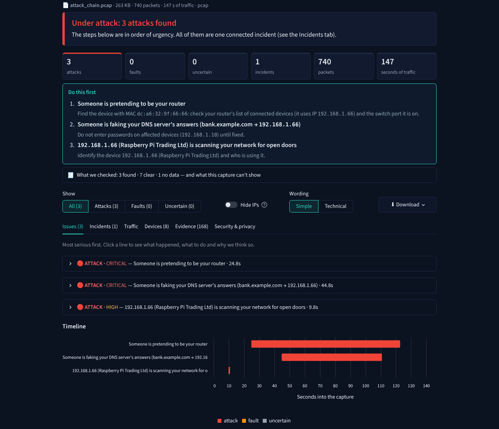
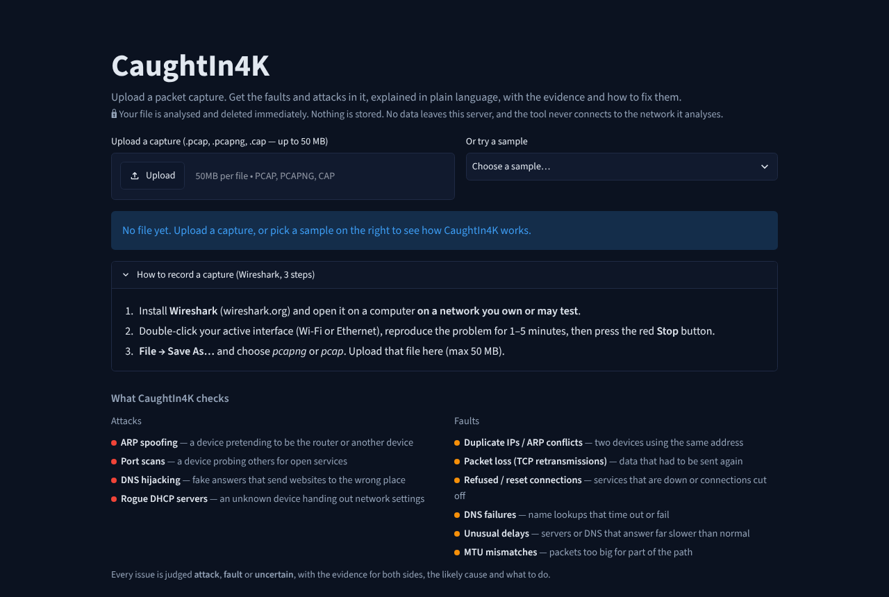
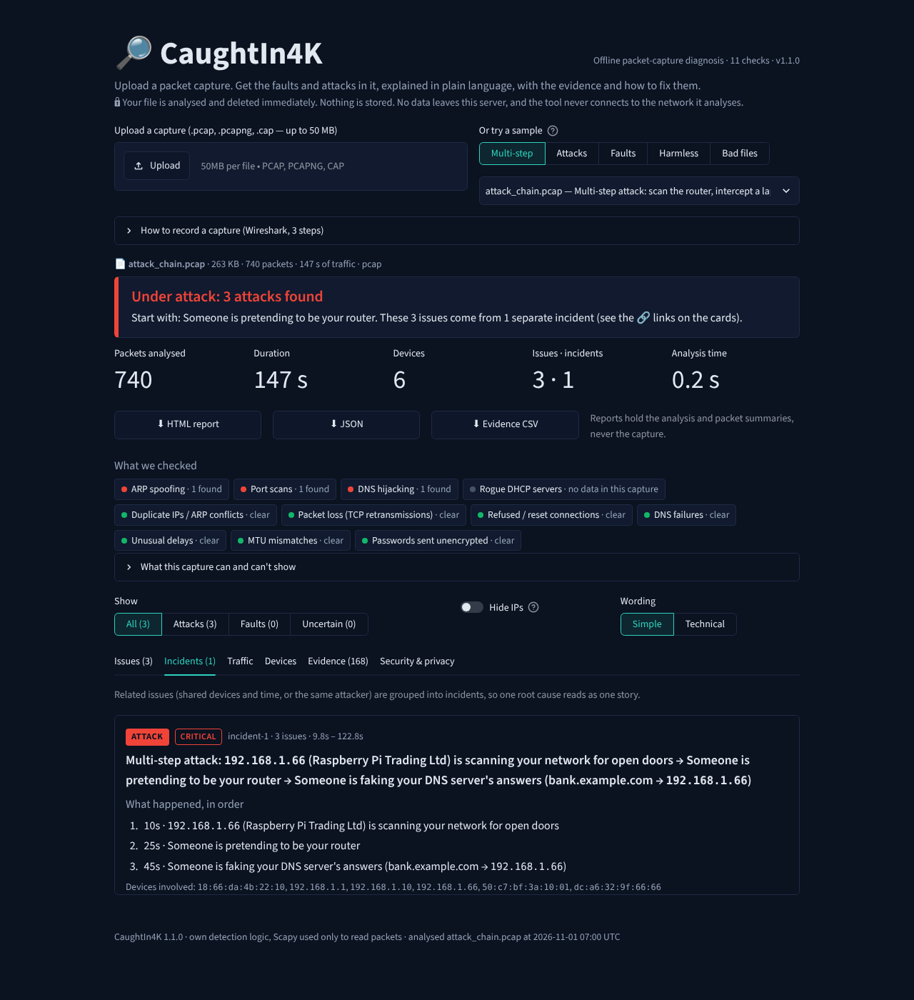
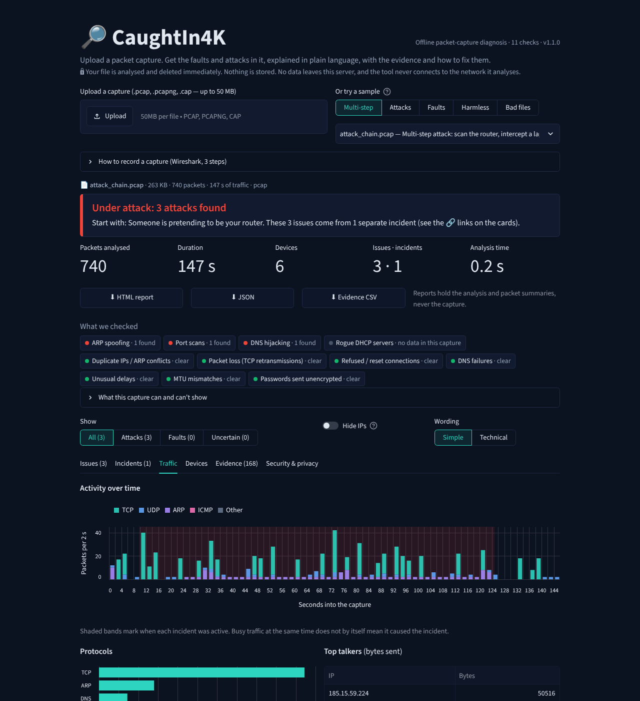
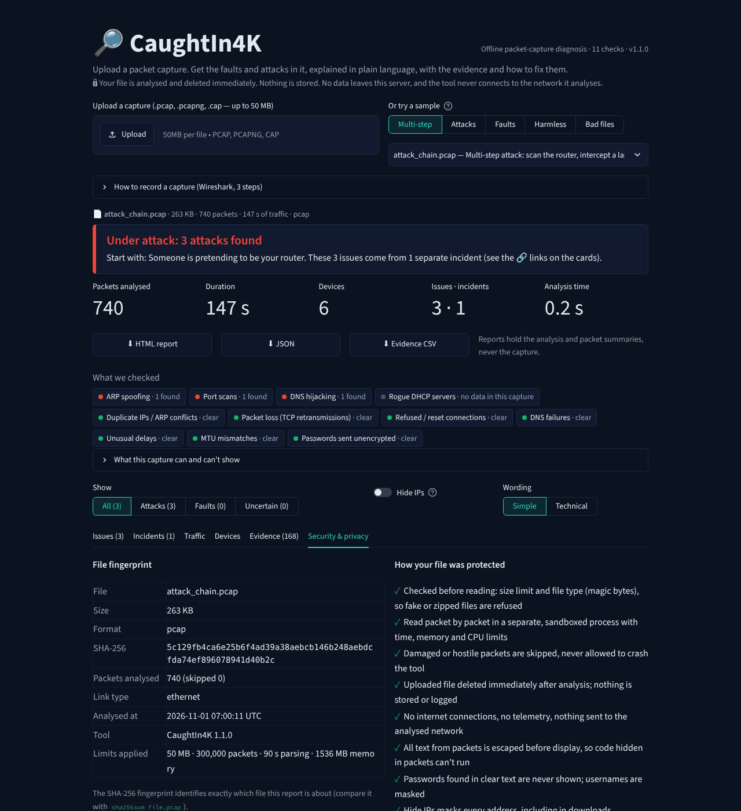
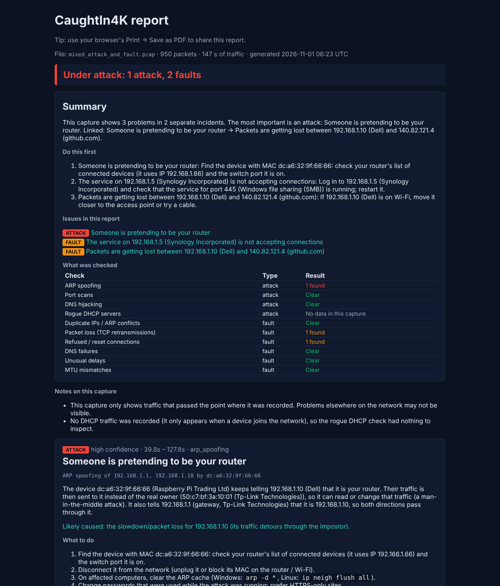
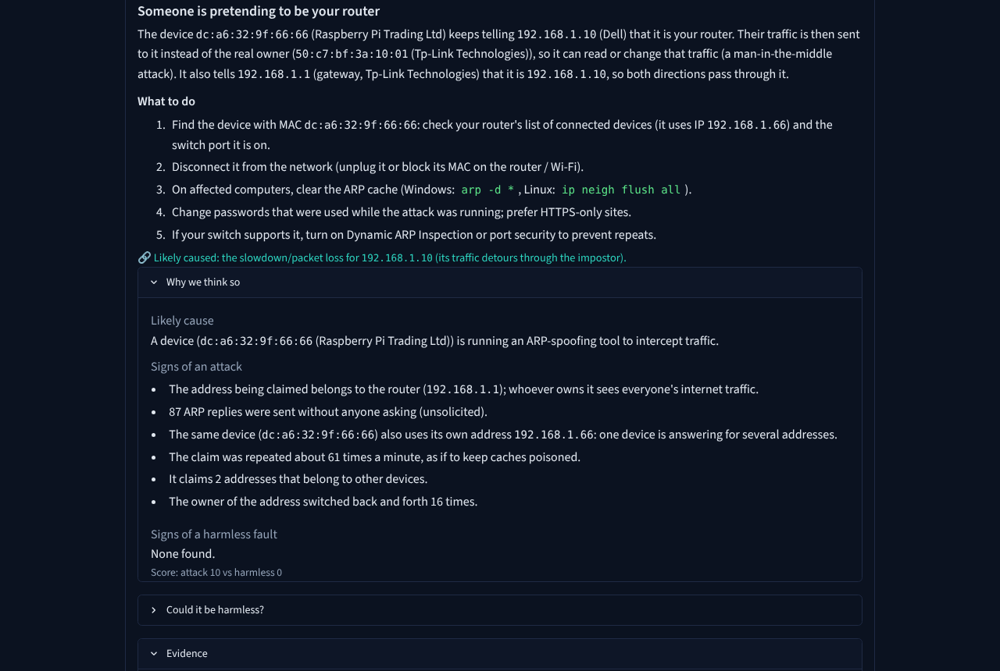
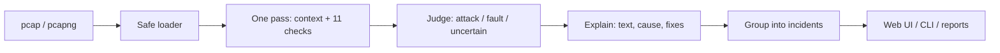

# CaughtIn4K

**Live site: <https://caughtin4k.streamlit.app/>**  ·  **Demo video:** _link coming soon_

Upload a packet capture. CaughtIn4K finds the **faults and attacks** in it, tells you **which is which**, explains them
in plain language with a fix for each, and shows the exact packets as proof.

*IIITDM Kancheepuram 24-hour Cybersecurity Hackathon · Network track: Diagnosing Network Problems from Packet Captures.*



## The problem

Small offices and campus labs have no network or security expert. When the network breaks, the cause is hidden in a
packet capture that only experts can read, and **a harmless fault looks exactly like an attack** to a user
(a duplicate IP and ARP spoofing both cause random drop-outs). So people restart the router while the real problem continues.

## The solution

CaughtIn4K reads a `.pcap` / `.pcapng` file safely, runs **11 checks** written by us, and for every issue gives:

- a verdict: **attack**, **fault** or **uncertain**, with the evidence for *both* sides, plus a **severity** (critical → low);
- a plain-language explanation, the likely cause and **numbered fix steps**;
- the **exact packets** behind it, plus a Wireshark filter to verify it yourself;
- **incidents that tell the story**: related issues are grouped and ordered, e.g. *scan → impersonate the router → fake the bank's DNS*.

**What's different:** Wireshark shows packets without a diagnosis, and intrusion detectors (Snort, Suricata) report only attacks, for
experts. CaughtIn4K diagnoses faults *and* attacks for beginners, and reasons openly about which one it is. The same
symptom (one IP claimed by two devices) is judged **attack** in `arp_spoof.pcap`, **fault** in `duplicate_ip.pcap`
and **uncertain** in `router_replacement.pcap`.

| Checks for attacks | Checks for faults |
|---|---|
| ARP spoofing · Port scans · DNS hijacking · Rogue DHCP servers | Duplicate IPs / ARP conflicts · Packet loss (TCP retransmissions) · Refused / reset connections · DNS failures · Unusual delays · MTU mismatches · Passwords sent unencrypted |

## Features

- **Answer first:** a red / amber / green banner and key numbers, then tabs:
  - **Issues:** one card per problem with verdict, severity, confidence, plain explanation, numbered fix steps,
    *Why we think so* (signs for and against), *Could it be harmless?*, evidence packets and a Wireshark filter.
  - **Incidents:** related issues as one story, in time order (e.g. a multi-step attack).
  - **Traffic:** activity over time with incident bands, protocols, top talkers, largest conversations.
  - **Devices:** IP, MAC, vendor and role, with impostors and rogue servers highlighted.
  - **Evidence:** every cited packet in one searchable table, with Wireshark frame numbers.
  - **Security & privacy:** the file's SHA-256 fingerprint, the limits applied, and how the file was protected.
- **What we checked:** every check shows *clear*, *found* or *no data in this capture*.
- **Proof, not just alerts:** e.g. it shows that an ARP impostor actually **relays** traffic (man in the middle) and
  **which device forged** DNS answers.
- **Simple / Technical** wording, **Attacks / Faults / Uncertain** filter, **Hide IPs** (masks addresses everywhere, including downloads).
- Downloads: **HTML report** (contents, summary, "do this first", findings table, incidents, traffic, capture details
  with SHA-256, method; printable), **JSON**, **evidence CSV**.
- **CLI** using the same engine, and **20 sample captures** in 5 groups, so no network setup is needed.

| Home | Incidents | Traffic |
|---|---|---|
|  |  |  |
| **Security & privacy** | **HTML report** | **Issue card** |
|  |  |  |

## Setup

Python **3.11+** (tested on 3.11, 3.12, 3.13).

```bash
git clone https://github.com/vishnu-1709/caughtin4k.git
cd caughtin4k
python -m venv .venv
source .venv/bin/activate          # Windows: .venv\Scripts\activate
pip install -r requirements.txt
```

**Website** (only reachable from your own computer):

```bash
streamlit run app.py --server.address 127.0.0.1
```

Then open <http://127.0.0.1:8501> and upload a capture or pick a sample.

**Command line:**

```bash
python cli.py samples/mixed_attack_and_fault.pcap
python cli.py capture.pcapng --redact -o report.html --csv evidence.csv
```

Options: `--json`, `--redact`, `-o report.html`, `--csv file.csv`, `--technical`. Exit codes: `0` healthy, `1` faults, `2` attacks, `3` unreadable file.

**Tests and evaluation:**

```bash
pip install -r requirements-dev.txt
python -m pytest
python evaluate.py
```

## Privacy

- Uploaded files are analysed and **deleted immediately**, even if something fails. Nothing is stored or logged.
- The tool only reads files. It never captures traffic, sends packets or makes network calls (telemetry off).
- **Hide IPs** / `--redact` masks IP and MAC addresses on screen and in every download.
- Passwords found in clear-text logins are **never stored or shown**; usernames are masked (`a***n`).

## How it works



Code lives in `engine/`: `loader.py` (safe reading), `context.py` (devices, gateway, DNS/DHCP servers),
`detectors/` (one file per check), `judge.py`, `explain.py`, `grouping.py`, `report.py`, `redact.py` and `config.py`
(all thresholds in one place).

### Detection rules (our own logic; Scapy only parses packets)

"Unusual" means compared with the capture's own median **and** above a fixed minimum.

| Check | Rule |
|---|---|
| ARP spoofing / duplicate IP | One IP claimed by two MACs. The judge weighs signs like *router address involved, unasked replies, repeated claims, claimant also has its own IP, claimant relays others' traffic* against *replies answer real requests, both devices have normal traffic, old device went silent (replacement)* |
| Port scan | One source tries ≥15 ports or hosts within 60 s, and under 30% become real connections |
| DNS hijacking | Answer from a server nobody asked, two different answers to one question, a public site resolving to a local address, a DNS server handed out only by a rogue DHCP server, or answers sent from a different device than the real DNS server (forged) |
| Rogue DHCP | More than one DHCP server answering; attack if it hands out a different router or DNS, fault if settings match (backup server) |
| Packet loss | Same data (flow + sequence number) sent again: ≥5 times and ≥5% of a connection's data |
| Resets | Many clients refused by one server:port = service down; mid-connection resets with an unusual TTL may be forged |
| DNS failures | Questions with no answer in 2 s, high SERVFAIL/REFUSED rate, bursts of "no such name" (random-looking names flagged as possible malware) |
| Delays | Connection setup or DNS answers slower than 3× the capture median (min. 300 ms / 500 ms), repeatedly |
| MTU | ICMP "fragmentation needed", or big packets resent and never acknowledged while small ones pass |
| Clear-text passwords | Login commands (FTP/POP3 `USER`/`PASS`, IMAP `LOGIN`, SMTP `AUTH`, HTTP Basic or a form `password=` field) sent unencrypted |

**Judge:** each sign has a weight. *Attack* requires strong attack evidence that clearly beats the harmless explanation.
Mixed evidence gives **uncertain**, and then the fix steps start with checks rather than drastic action. Confidence is low/medium/high (no fake percentages). **Severity** (critical/high/medium/low) says how much damage the problem can do. **Incidents** group issues that share devices and time, or the same attacker.

## Security

| Risk | What we do |
|---|---|
| Huge, broken or fake files | size limit before parsing, file-type check by magic bytes, streaming reader, bad packets skipped, truncated files give partial results |
| Parser hangs or crashes | analysis runs in a separate process with time, memory and CPU limits |
| Overloading the hosted service | at most 2 analyses at once and a per-visitor rate limit |
| Proving which file was analysed | SHA-256 fingerprint shown in the app and in every report |
| Script code inside packets (e.g. DNS names with `<script>`) | all packet text is escaped; the HTML report also blocks scripts with a Content-Security-Policy |
| CSV / terminal / path tricks | spreadsheet formulas neutralised, control characters stripped, output paths can't leave the current folder |
| Data leaks and secrets | uploads deleted right away, no logging of packet data, no network calls, passwords never shown, no secrets in the repo |
| Web app hardening | XSRF and CORS protection explicitly on, error details hidden from visitors (`showErrorDetails = "none"`), telemetry off |

## Evaluation

`python evaluate.py --markdown` on the included samples:

| Sample | Expected | Detected (verdict) | Missed | False positives | Verdicts right |
|---|---|---|---|---|---|
| `attack_chain.pcap` | port_scan (attack), arp_spoofing (attack), dns_hijack (attack) | arp_spoofing (attack), dns_hijack (attack), port_scan (attack) | — | — | ✅ |
| `cleartext_logins.pcap` | cleartext_credentials (fault), cleartext_credentials (fault) | cleartext_credentials (fault), cleartext_credentials (fault) | — | — | ✅ |
| `mixed_attack_and_fault.pcap` | arp_spoofing (attack), tcp_retransmissions (fault), service_refused (fault) | arp_spoofing (attack), service_refused (fault), tcp_retransmissions (fault) | — | — | ✅ |
| `clean.pcap` | — | — | — | — | ✅ |
| `arp_spoof.pcap` | arp_spoofing (attack) | arp_spoofing (attack) | — | — | ✅ |
| `duplicate_ip.pcap` | duplicate_ip (fault) | duplicate_ip (fault) | — | — | ✅ |
| `port_scan.pcap` | port_scan (attack) | port_scan (attack) | — | — | ✅ |
| `rogue_dhcp_dns_hijack.pcap` | rogue_dhcp (attack), dns_hijack (attack) | rogue_dhcp (attack), dns_hijack (attack) | — | — | ✅ |
| `dns_failures.pcap` | dns_timeout (fault), dns_servfail (fault), slow_dns (fault) | dns_timeout (fault), dns_servfail (fault), slow_dns (fault) | — | — | ✅ |
| `tcp_retransmissions.pcap` | tcp_retransmissions (fault) | tcp_retransmissions (fault) | — | — | ✅ |
| `mtu.pcap` | mtu_mismatch (fault), mtu_mismatch (fault) | mtu_mismatch (fault), mtu_mismatch (fault) | — | — | ✅ |
| `router_replacement.pcap` | ip_conflict (uncertain) | ip_conflict (uncertain) | — | — | ✅ |
| `busy_browsing.pcap` | — | — | — | — | ✅ |
| `backup_dhcp.pcap` | rogue_dhcp (fault) | rogue_dhcp (fault) | — | — | ✅ |
| `malicious_xss_dnsname.pcap` | dns_nxdomain (fault) | dns_nxdomain (fault) | — | — | ✅ |
| `slow_handshakes.pcap` | slow_responses (fault) | slow_responses (fault) | — | — | ✅ |
| `tcp_resets_service_down.pcap` | service_refused (fault) | service_refused (fault) | — | — | ✅ |
| `broken_truncated.pcap` | — | partial result + warning | — | — | ✅ |
| `not_a_pcap.pcap` | — | rejected (not_pcap) | — | — | ✅ |
| `malformed_huge_record.pcap` | — | partial result + warning | — | — | ✅ |

**24/24 issues found with the right verdict, 0 false alarms**, including three harmless look-alikes (router replacement,
busy browsing, backup DHCP server) and three damaged or hostile files handled safely. A 47 MB capture (97k packets)
takes about 18 s.

The samples are synthetic (made with `generate_samples.py`) and were built alongside the rules. They show that each rule
works as designed, but they don't measure accuracy on real-world traffic.

## Known limitations

- Only sees traffic at the point where the capture was recorded.
- Encrypted DNS (DoH/DoT) and QUIC hide details some checks need.
- IPv6-specific attacks are not covered.
- Very slow scans (spread over more than a minute) and exact MAC cloning can evade detection.
- The hosted site is limited to 50 MB files and 90 s of analysis; run it locally for more.

## Libraries used

| Library | Licence | Used for |
|---|---|---|
| [Scapy](https://scapy.net/) 2.8.0 | GPL-2.0 | reading capture files (and creating the samples) |
| [Streamlit](https://streamlit.io/) 1.66.1 | Apache-2.0 | web interface |
| [pandas](https://pandas.pydata.org/) 3.1.0 | BSD-3-Clause | tables |
| [Vega-Altair](https://altair-viz.github.io/) 6.3.0 | BSD-3-Clause | charts |
| [pytest](https://pytest.org/) 9.2.0 | MIT | tests only |

These pull in their usual dependencies (NumPy, PyArrow and others). MAC vendor names come from Scapy's built-in
offline database. No external APIs are used, and Wireshark/tshark are not used.

## Responsible use

Only analyse captures from networks you own or have permission to test. All samples here are synthetic; no real traffic was captured.

## Licence

GPL-2.0 (same as Scapy). See [LICENSE](LICENSE).
